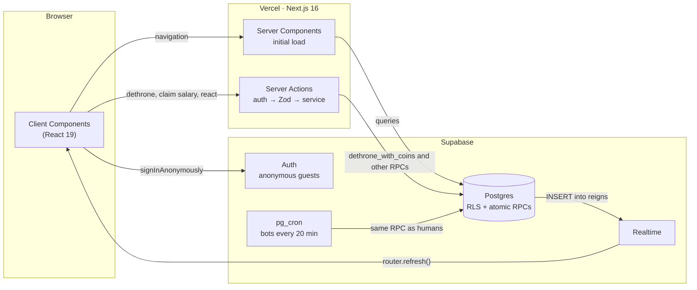

# 👑 CoronaTeOnline

[](https://github.com/nicob201/coronateonline/actions/workflows/ci.yml)

🇦🇷 [Leer en español](README.es.md)

**🌐 Live demo: [coronateonline.vercel.app](https://coronateonline.vercel.app)**. Enter as a guest with one click and play within 30 seconds: no sign-up, no payment.


A status market: you compete for unique, absurd titles (**Rey de Córdoba**, **CEO de los Lunes**, **Rey de la Pizza**) by paying more than whoever holds them. Whoever pays gets crowned; the dethroned one goes to cry on social media. The UI is in Spanish (Argentina), the code and docs are in English, except the architecture decision records, which are in Spanish.

## How it plays

- Every title has a king and a price. To dethrone them you pay the price + 1 👑, and the dethroned holder keeps your Coronas.
- There are no auctions or timers: the crown is yours until someone pays more. If nobody contests it, the price slowly decays.
- You start with 20 👑 and collect a daily salary that grows with your streak. Five bots play by the same rules so the realm is never still.

## What's in it

- **Real time:** the ticker, prices and kings update on their own, and a bell tells you when you get dethroned.
- **Realm Map** (`/mapa`): a globe with the 24 IGN provinces, each with its crown, glowing brighter the pricier it is.
- **Rankings** (`/rankings`) and **achievements** on the profile, all derived from the reign history.
- **Community titles:** propose one for 30 👑 and an admin approves it.
- **🍅 / 👏 reactions** to the current king, live for everyone.
- **Search and filters** on `/titulos`, with all state in the URL.
- **Case study** (`/acerca`): the problem, the architecture, the 7 decisions with what each cost, and what would change today.
- **Lighthouse in production (mobile):** 100 performance on the home page and `/titulos`, 99 on `/mapa`; 100 in accessibility, best practices and SEO.

## Architecture



Data is loaded in Server Components and reaches Client Components as props. Everything that writes goes through a Server Action, which validates with Zod and delegates to a service. A few rules the design rests on:

- **One source of truth.** A title's king and price are derived from `reigns`, and each user's balance from `coin_ledger`. Neither is stored in a column.
- **Everything that moves Coronas is atomic and lives in Postgres.** The server never charges the price the screen showed: the function re-validates it with the locks held.
- **RLS on every table.** The client can't write `titles`, `reigns` or the ledger; only `SECURITY DEFINER` functions do.

### Architecture decisions

The ADRs are written in Spanish.

| ADR | Decision |
|---|---|
| [0001](docs/adr/0001-coronas-y-saldo-derivado.md) | Integer Coronas and a balance derived from the ledger |
| [0002](docs/adr/0002-destronar-en-una-funcion-atomica.md) | Dethroning only inside an atomic Postgres function |
| [0003](docs/adr/0003-estado-derivado-de-reigns.md) | Current king, price and notifications derived from `reigns` |
| [0004](docs/adr/0004-bots-con-las-mismas-reglas.md) | Bots that play by the same rules, from `pg_cron` |
| [0005](docs/adr/0005-tiempo-real-con-router-refresh.md) | Real time: a database change triggers a `router.refresh()` |
| [0006](docs/adr/0006-mapa-sin-proveedor-de-tiles.md) | Map with MapLibre and our own IGN GeoJSON, no map provider |
| [0007](docs/adr/0007-invitados-desde-el-navegador.md) | Guests sign in from the browser, no captcha |

More context: the product spec in [`docs/DESIGN.md`](docs/DESIGN.md), the code rules in [`AGENTS.md`](AGENTS.md), the day-by-day plan in [`docs/ROADMAP.md`](docs/ROADMAP.md) and the designs of the larger features in [`docs/superpowers/specs/`](docs/superpowers/specs/).

## Stack

Next.js 16 (App Router) · React 19 · TypeScript · Tailwind CSS v4 · Supabase (Postgres, Auth, Realtime, Storage, pg_cron, PostGIS) · MapLibre GL · Zod · Vitest · Playwright · Vercel

## Quality

Every PR goes through two CI jobs ([`ci.yml`](.github/workflows/ci.yml)):

- **`verify`:** lint, typecheck, Vitest tests and a production build.
- **`integration`:** starts Supabase in Docker and runs the SQL tests of every RPC ([`supabase/tests/`](supabase/tests/)), including a concurrency test with real parallel sessions (same-title race, double spend, two users dethroning each other), then a Playwright E2E: enter as a guest, dethrone and see the coronation in the ticker.

The schema lives in versioned migrations ([`supabase/migrations/`](supabase/migrations/)). A daily workflow requests `/titulos` so Supabase doesn't pause the free-tier project.

## Run locally

You need Node 20 or later and Docker (Docker Desktop, colima or OrbStack).

```bash
npm install
npx supabase start            # Postgres, Auth and Realtime in Docker, with sample data
cp .env.example .env.local    # fill in API_URL and ANON_KEY from `npx supabase status -o env`
npm run dev
```

| Command | What it does |
|---|---|
| `npm run dev` | Development server |
| `npm run verify` | Lint, typecheck, tests and build: the same as CI's `verify` job |
| `npm run test:sql` | SQL tests of the RPCs plus the concurrency test. Needs `SUPABASE_DB_URL` pointing at the local stack |
| `npm run test:e2e` | Playwright against the local stack. Resets the local database first |

Before `dev`, `build` and `test:sql`, a check stops everything if any local Supabase URL doesn't belong to this project's containers, so it never writes to another project's database.

## Structure

```
src/
  app/          pages (App Router): call a service and pass props
  actions/      Server Actions: auth → validation → service → revalidate
  services/     business logic and Supabase queries
  features/     per-feature code (components, hooks, schemas)
  components/   shared UI
  lib/          utilities, Zod-validated env and Supabase clients
supabase/
  migrations/   versioned schema
  tests/        SQL tests of the RPCs and the concurrency test
e2e/            Playwright tests
docs/           design, roadmap and ADRs
```

## Credits and licenses

- **Code:** [MIT](LICENSE).
- **Map data:** `public/geo/argentina.json` is derived from the IGN's `provincia` layer and is **not** covered by the MIT license. It follows the [IGN's terms of use](https://www.ign.gob.ar/descargas/tyc1.html): *FUENTE: Instituto Geográfico Nacional de la República Argentina*, data downloaded in October 2026, shared free of charge. This project is not affiliated with or endorsed by the IGN.
- **Fonts:** Inter, Montserrat and JetBrains Mono, self-hosted under the SIL Open Font License ([`src/app/fonts/OFL.txt`](src/app/fonts/OFL.txt)).
- **Icons:** a subset of Google's Material Symbols (Apache-2.0).
- **Maps engine:** [MapLibre GL](https://maplibre.org) (BSD-3-Clause).
