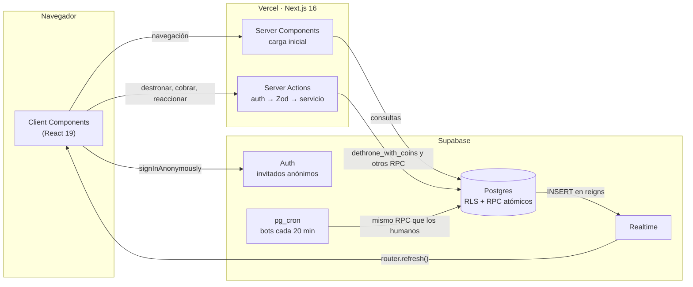

# 👑 CoronaTeOnline

[](https://github.com/nicob201/coronateonline/actions/workflows/ci.yml)

**🌐 Demo en vivo: [coronateonline.vercel.app](https://coronateonline.vercel.app)**. Entrás como invitado con un clic y jugás en 30 segundos, sin registrarte ni pagar.

Un mercado de estatus: competís por títulos únicos y absurdos (**Rey de Córdoba**, **CEO de los Lunes**, **Rey de la Pizza**) pagando más que el que los tiene. El que paga, corona. El destronado, a llorar a las redes.

## Cómo se juega

- Cada título tiene un rey y un precio. Para destronarlo pagás el precio + 1 👑, y el destronado se queda con tus Coronas.
- No hay subastas ni timers: la corona es tuya hasta que alguien pague más. Si nadie la disputa, el precio baja de a poco.
- Arrancás con 20 👑 y cobrás un sueldo diario que crece con la racha. Cinco bots juegan con las mismas reglas para que el reino nunca esté quieto.

## Qué tiene

- **Tiempo real:** el ticker, los precios y los reyes se actualizan solos, y una campanita te avisa cuando te destronan.
- **Mapa del Reino** (`/mapa`): un globo con las 24 provincias del IGN, cada una con su corona, que brilla más cuanto más cara está.
- **Rankings** (`/rankings`) y **logros** en el perfil, calculados a partir de los reinados.
- **Títulos de la comunidad:** proponés uno por 30 👑 y un admin lo aprueba.
- **Reacciones 🍅 / 👏** al rey actual, en vivo para todos.
- **Búsqueda y filtros** en `/titulos`, con todo el estado en la URL.
- **Lighthouse en producción (mobile):** 100 de rendimiento en la home y `/titulos`, 99 en `/mapa`; 100 en accesibilidad, buenas prácticas y SEO.

## Arquitectura



Los datos se cargan en Server Components y llegan a los Client Components como props. Todo lo que escribe pasa por una Server Action, que valida con Zod y delega en un servicio. Algunas reglas que sostienen el diseño:

- **Una sola fuente de verdad.** El rey y el precio de un título se derivan de `reigns`, y el saldo de cada usuario, de `coin_ledger`. Ninguno se guarda en una columna.
- **Todo lo que mueve Coronas es atómico y vive en Postgres.** El servidor nunca cobra el precio que mostró la pantalla: la función vuelve a validarlo con los locks tomados.
- **RLS en todas las tablas.** El cliente no puede escribir `titles`, `reigns` ni el ledger; solo las funciones `SECURITY DEFINER` lo hacen.

### Decisiones de arquitectura

| ADR | Decisión |
|---|---|
| [0001](docs/adr/0001-coronas-y-saldo-derivado.md) | Coronas enteras y saldo derivado del ledger |
| [0002](docs/adr/0002-destronar-en-una-funcion-atomica.md) | Destronar solo dentro de una función atómica de Postgres |
| [0003](docs/adr/0003-estado-derivado-de-reigns.md) | Rey actual, precio y notificaciones derivados de `reigns` |
| [0004](docs/adr/0004-bots-con-las-mismas-reglas.md) | Bots que juegan con las mismas reglas, desde `pg_cron` |
| [0005](docs/adr/0005-tiempo-real-con-router-refresh.md) | Tiempo real: el cambio en la base dispara un `router.refresh()` |
| [0006](docs/adr/0006-mapa-sin-proveedor-de-tiles.md) | Mapa con MapLibre y un GeoJSON propio del IGN, sin proveedor de mapas |
| [0007](docs/adr/0007-invitados-desde-el-navegador.md) | Los invitados entran desde el navegador, sin captcha |

Más contexto: la spec del producto en [`docs/DESIGN.md`](docs/DESIGN.md), las reglas de código en [`AGENTS.md`](AGENTS.md), el plan día por día en [`docs/ROADMAP.md`](docs/ROADMAP.md) y los diseños de las features grandes en [`docs/superpowers/specs/`](docs/superpowers/specs/).

## Stack

Next.js 16 (App Router) · React 19 · TypeScript · Tailwind CSS v4 · Supabase (Postgres, Auth, Realtime, Storage, pg_cron, PostGIS) · MapLibre GL · Zod · Vitest · Playwright · Vercel

## Calidad

Cada PR pasa por dos jobs de CI ([`ci.yml`](.github/workflows/ci.yml)):

- **`verify`:** lint, typecheck, tests de Vitest y build de producción.
- **`integration`:** levanta Supabase en Docker, corre los tests SQL de cada RPC ([`supabase/tests/`](supabase/tests/)) y un E2E con Playwright: entrar como invitado, destronar y ver la coronación en el ticker.

El esquema vive en migraciones versionadas ([`supabase/migrations/`](supabase/migrations/)). Un workflow diario pide `/titulos` para que Supabase no pause el proyecto gratuito.

## Correr en local

Necesitás Node 20 o más y Docker (Docker Desktop, colima u OrbStack).

```bash
npm install
npx supabase start            # Postgres, Auth y Realtime en Docker, con datos de ejemplo
cp .env.example .env.local    # completá con API_URL y ANON_KEY de `npx supabase status -o env`
npm run dev
```

| Comando | Qué hace |
|---|---|
| `npm run dev` | Servidor de desarrollo |
| `npm run verify` | Lint, typecheck, tests y build: lo mismo que el job `verify` de CI |
| `npm run test:sql` | Tests SQL de los RPC. Necesita `SUPABASE_DB_URL` apuntando al stack local |
| `npm run test:e2e` | Playwright contra el stack local. Resetea la base local antes de correr |

Antes de `dev`, `build` y `test:sql`, un chequeo frena todo si alguna URL local de Supabase no pertenece a los contenedores de este proyecto, para no escribir nunca en la base de otro.

## Estructura

```
src/
  app/          páginas (App Router): llaman a un servicio y pasan props
  actions/      Server Actions: auth → validación → servicio → revalidate
  services/     lógica de negocio y consultas a Supabase
  features/     código de cada feature (componentes, hooks, schemas)
  components/   UI compartida
  lib/          utilidades, env validado con Zod y clientes de Supabase
supabase/
  migrations/   esquema versionado
  tests/        tests SQL de los RPC
e2e/            tests de Playwright
docs/           diseño, roadmap y ADRs
```
